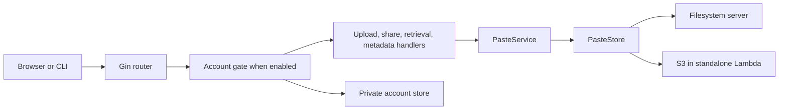

# Architecture

## Composition and request flow

`main.go` loads `config/config.go`, chooses a storage backend, constructs
`internal/services/PasteService`, then registers Gin handlers and static templates.
Server mode uses `storage/filesystem.go`; Lambda mode uses `storage/s3.go` through
the `PasteStore` interface. Deployment detection uses `AWS_LAMBDA_FUNCTION_NAME`.

The gate runs before both legacy and new content handlers. User administration
uses the separate account store. Static files/templates are loaded from the
runtime `static/` directory, including shared header and receiver partials.

## Modules and data ownership

| Area | Responsibility |
|---|---|
| `handlers/upload/`, `handlers/retrieval/`, `handlers/meta.go` | Legacy HTTP compatibility |
| `handlers/shares.go` | Versioned multipart uploads and browser content responses |
| `handlers/account_access.go`, `handlers/accounts.go`, `handlers/account_shares.go` | Authentication, independent permissions and management |
| `internal/accounts/store.go` | Atomic private user/session storage, password hashing and revisions |
| `internal/services/paste_service.go` | Paste lifecycle and process-local destructive-reader coordination |
| `models/paste.go`, `models/share.go` | Metadata and logical items/representations |
| `storage/` | Filesystem/S3 persistence and content statistics |
| `static/` | Composer, clipboard adaptation, requests, receiver, settings and account UI |

Paste content is stored as `{slug}` and JSON metadata as `{slug}.json`. One
representation remains raw bytes; multi-item or multi-representation content is
a server-created ZIP. Optional `share` and `public` metadata preserve old records.
The exact format is defined in [ARC-SHARING.md](ARC-SHARING.md).

Accounts and hashed session credentials live in `.accounts/accounts.json` below
the configured data directory. Listings do not traverse that private directory.
The store uses an in-process lock and atomic replacement; two application writers
against the same data/account directory are unsupported. Public access is one
boolean per share, not an ownership or per-user ACL model.

## Boundaries and route ownership

[ACCOUNTS.md](ACCOUNTS.md) owns login/session/user/admin routes and their access
rules. [ARC-SHARING.md](ARC-SHARING.md) owns share routes, manifests and one-time
delivery. [CLIENTS.md](CLIENTS.md) owns the legacy route table;
[X-HEADERS.md](X-HEADERS.md) owns header semantics. `GET /health` is deliberately
public; other API capabilities follow the selected authentication mode.

Upload, download and manage permissions are independent. Login/edit operations
bind sessions to the user version; edits revoke prior sessions. Browser mutations
require CSRF/origin checks, while explicit CLI credentials follow the same user
permissions. Uploaded HTML is representation data, not executable preview markup.
Only UI preferences are persisted by the browser.

One-time browser pages display confirmation without loading body/thumbnail.
Confirmed receive and legacy raw/CLI consumption coordinate within one process,
validate a complete read, then delete before responding. This cannot provide
cross-instance S3 exclusion or recover a response interrupted after deletion.
Content checks are detailed in [Content integrity](SIZE_MISMATCH_ARCHITECTURE.md).

Configuration defaults are maintained once in the root [README](../README.md).
Testing and release operations belong to [tests](INTEGRATION-TESTS.md) and
[manual maintenance](OPERATIONS.zh-CN.md); live deployment information is private.
